# 第1次練習題目-隨堂-QZ1

> 學號：113111135  
> 姓名：傅家青  
> 作業撰寫時間：80 mins（請依實際花費時間確認）  
> 最後撰寫文件日期：2026/10/10

本份文件包含以下主題：
- [x] 說明內容
- [x] 其他

## 說明內容

### 一、作業目的與專案建立

本次練習使用 Unity 6.2 建立 `QZ1-Unity` 3D 專案，先熟悉 Unity 編輯器的 Scene、Hierarchy、Inspector 與 Project 視窗，再練習場景視角操作、物件變形工具，以及以 Cube 組合簡單的 3D 角色。

在 Unity 中，Hierarchy 用來查看場景物件的階層關係；Scene 用於編輯與觀察物件；Inspector 可調整物件的 Transform 等屬性；Project 則用來管理場景、材質和 Prefab 等資源。

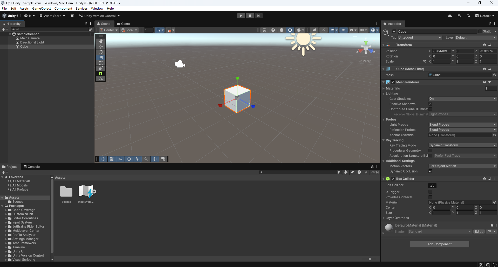

### 二、Scene 視角操作

#### 1. Zoom In 與 Zoom Out

透過縮放視角，分別觀察物件的近距離細節與場景整體配置。此操作改變的是 Scene 的觀看距離，不會直接修改模型的 Scale。

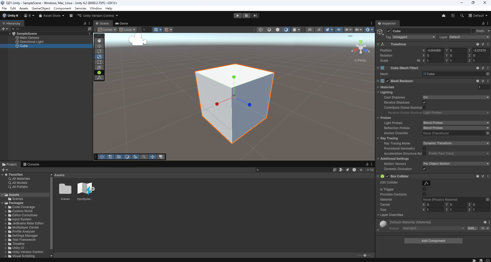

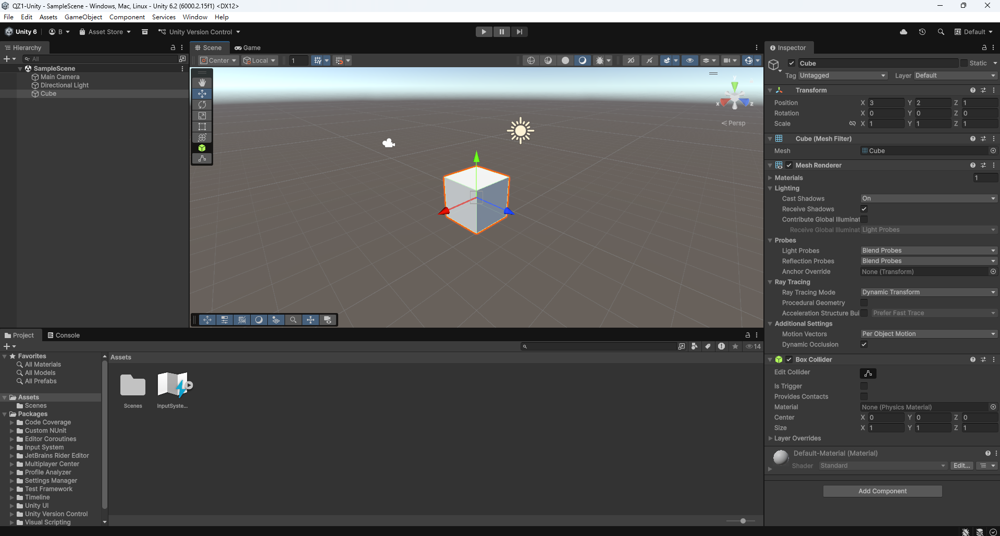

#### 2. Orbit

利用 Orbit 繞著觀察目標旋轉視角，確認物件在不同方向的形狀與位置關係。

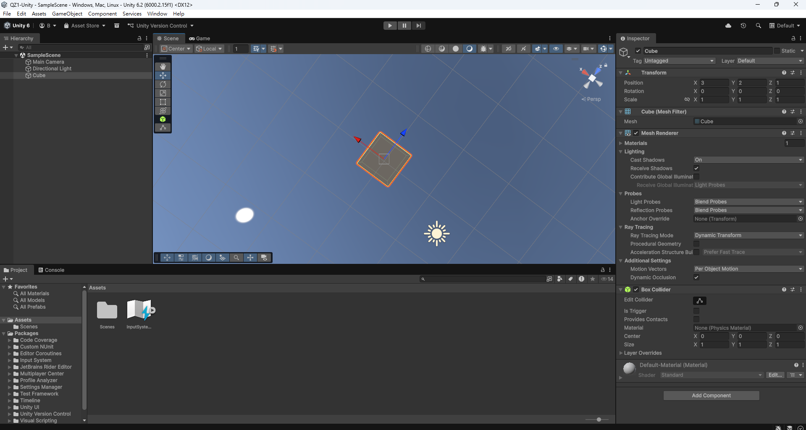

#### 3. Pan

利用 Pan 平移 Scene 視角，以便查看畫面不同區域；這與使用 Move Tool 移動物件不同。

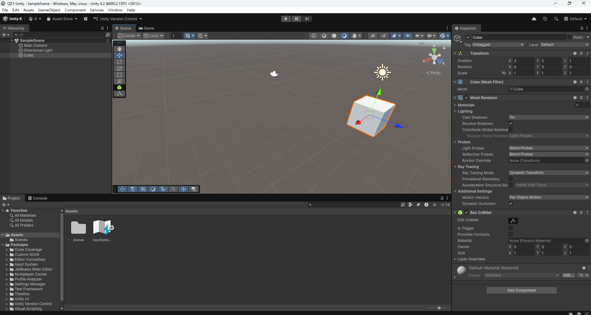

#### 4. Fly Mode

使用 Fly Mode 在 3D 場景中移動觀察位置，以下記錄操作前後的畫面差異。

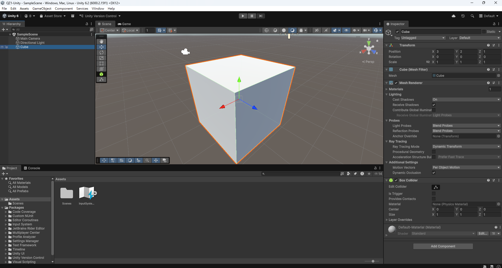

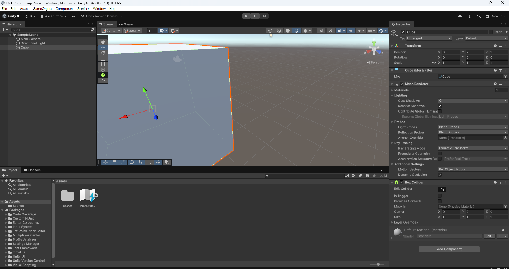

### 三、Gizmos 顯示設定

Gizmos 是 Scene 編輯時的輔助標示，可協助辨認攝影機、光源等物件。練習調整顯示大小，觀察畫面差異。這些輔助圖示並不是兔子模型的一部分。

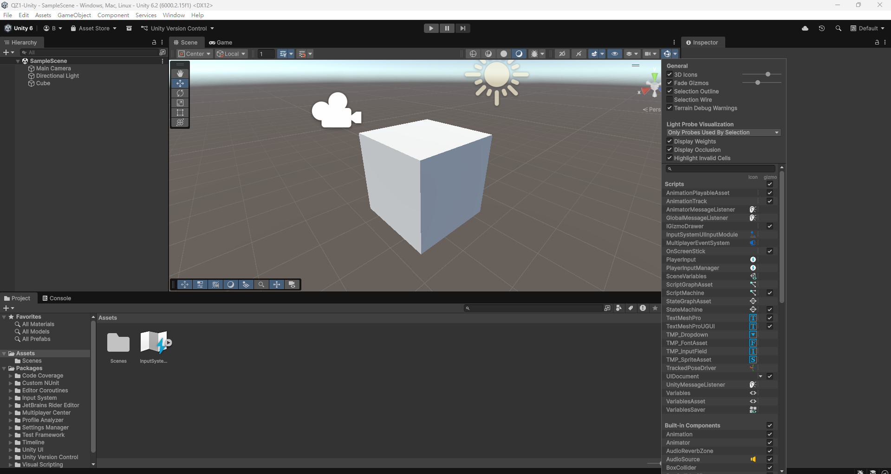

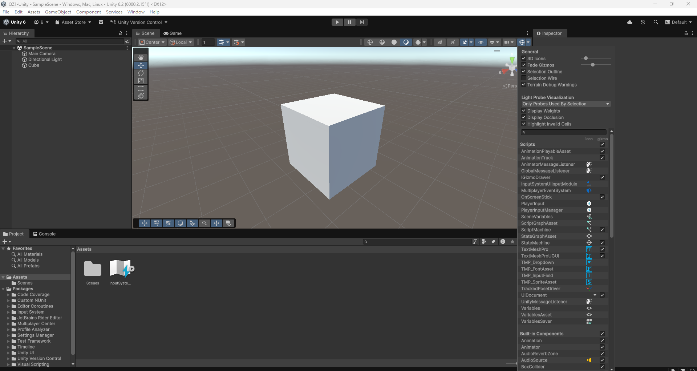

### 四、物件操作工具

Unity 提供數種常用工具，協助在場景中調整物件或改變觀看方式。

| 工具 | 快捷鍵 | 用途 |
| --- | --- | --- |
| Hand Tool | `Q` | 移動 Scene 的觀看視角 |
| Move Tool | `W` | 調整物件的位置（Position） |
| Rotate Tool | `E` | 調整物件旋轉角度（Rotation） |
| Scale Tool | `R` | 調整物件縮放比例（Scale） |
| Rect Tool | `T` | 透過矩形控制項調整物件 |
| Transform Tool | `Y` | 綜合操作物件的 Transform |

以下是各工具的練習截圖。

**Move Tool**

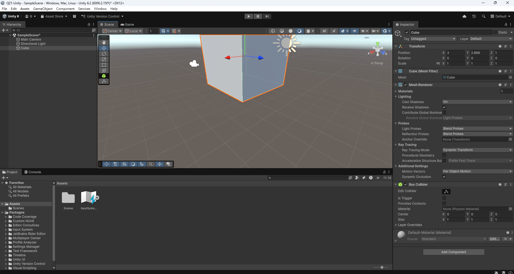

**Rotate Tool**

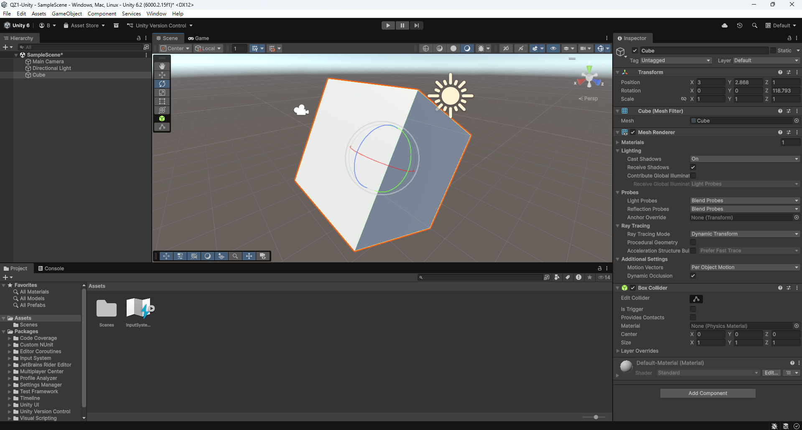

**Scale Tool**

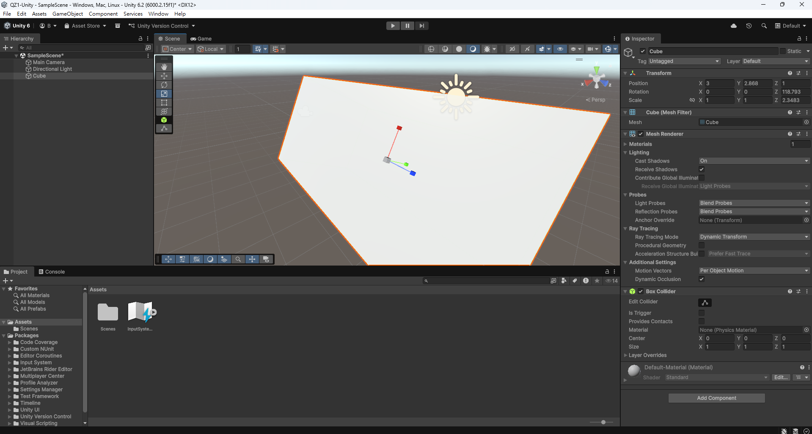

**Hand Tool**

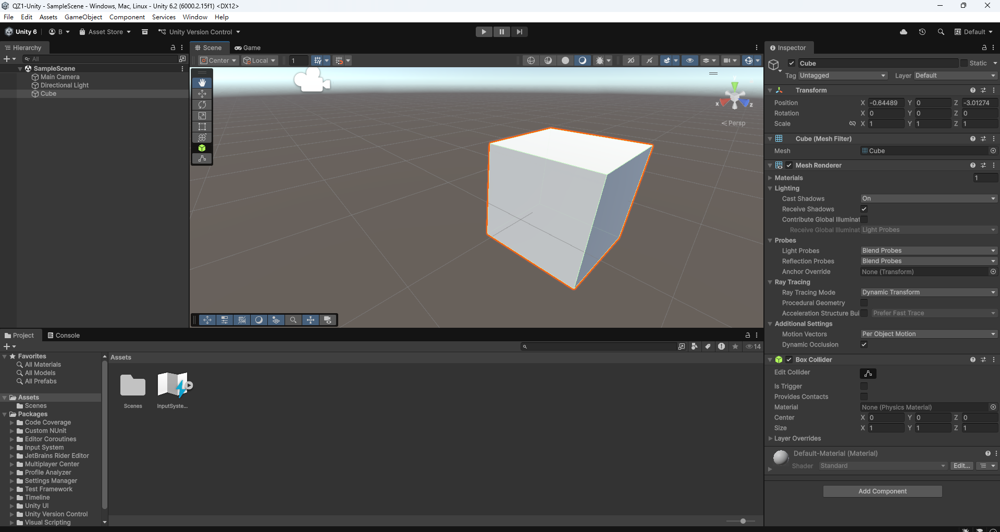

**Rect Tool**

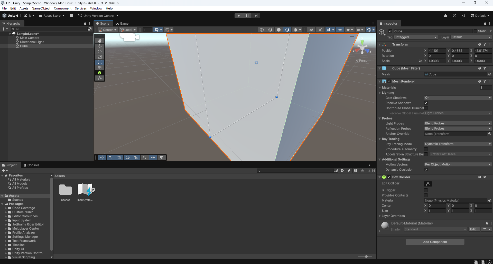

**Transform Tool**

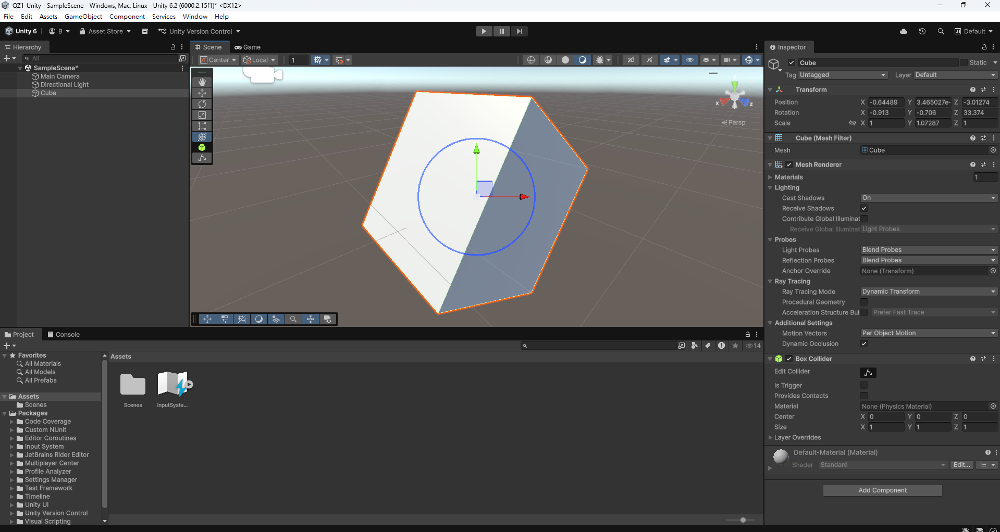

### 五、使用 Cube 製作方塊兔

為了練習 3D 物件組合，我使用多個 Cube 製作方塊兔，並在 Hierarchy 中建立父物件 `BlockRabbit`，將其他身體部件放在它的下方，方便整體管理。

| 階層物件名稱 | 角色部位 |
| --- | --- |
| `Body` | 身體 |
| `Head` | 頭部 |
| `LeftEar` | 左耳 |
| `RightEar` | 右耳 |
| `LeftEye` | 左眼 |
| `RightEye` | 右眼 |
| `Nose` | 鼻子 |

製作時透過 Move Tool 調整各部位的相對位置，再使用 Scale Tool 改變方塊長寬高，使其組合成具有身體、頭部、雙耳及五官的兔子。建模過程中也需要切換觀察角度，確認正面與側面的排列是否合適。

### 六、材質與角色外觀

在 `Assets/Materials` 資料夾中建立兩個材質：

- `RabbitPink`：主要套用於身體與頭部，呈現粉紅色。
- `RabbitBlack`：套用於眼睛與鼻子，呈現黑色。

兔子的耳朵保留白色，與粉紅色身體和黑色五官形成區別。藉由這項操作，我練習了建立 Material、設定顏色與套用至不同物件的流程。

### 七、建立 Prefab

完成角色後，在 `Assets/Prefabs` 建立資料夾，並把 Hierarchy 中的 `BlockRabbit` 拖曳到該資料夾，建立 `BlockRabbit` Prefab。

Prefab 能保存物件及其子物件組成的結構，未來如果需要在場景中重複放置相同角色，可以從 Project 視窗使用該 Prefab，而不必重新建立每個方塊。

### 八、成果整理

本次已練習 Unity 專案建立、Scene 視角控制、Gizmos 顯示調整，以及 Q／W／E／R／T／Y 等工具的操作。同時運用基本 3D 方塊建立兔子角色，設定材質並保存為 Prefab。這些練習有助於理解 Unity 如何組織與編輯遊戲場景中的物件。

以下為本次使用 Unity 製作的方塊兔最終成果。
角色由多個 Cube 組合而成，具有粉紅色身體、
白色耳朵及黑色五官。

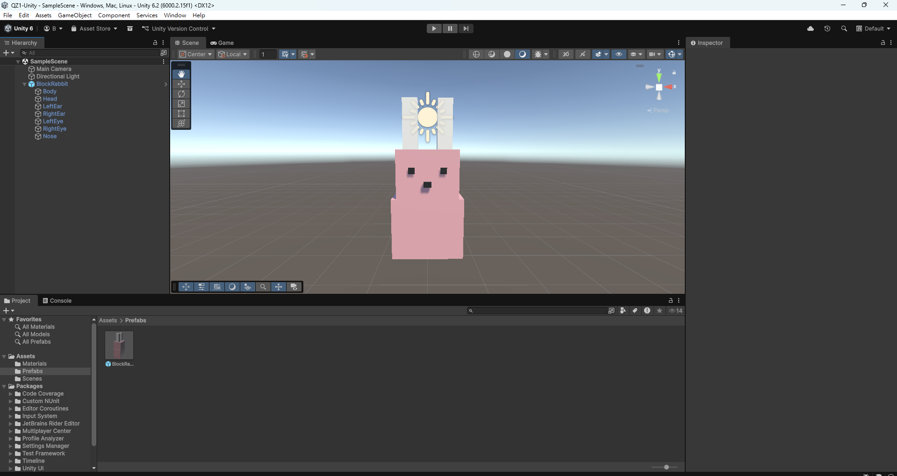

## 其他

### 學習心得

這次練習讓我更熟悉 Unity 編輯器的基本操作。一開始比較需要適應的是 Scene 視角移動與遊戲物件移動的區別；熟悉各工具後，才比較能準確調整物件的位置與大小。

製作方塊兔時，雖然使用的是簡單的 Cube，但仍需要不斷調整各部位的比例與排列方式，才能讓角色呈現預期的外觀。我也學到如何透過 Hierarchy 管理父子物件，以及利用 Material 和 Prefab 分別處理外觀與重複使用的需求。

希望之後能進一步學習使用 C# 控制角色動作，讓目前建立的 3D 模型具有更多互動功能。
